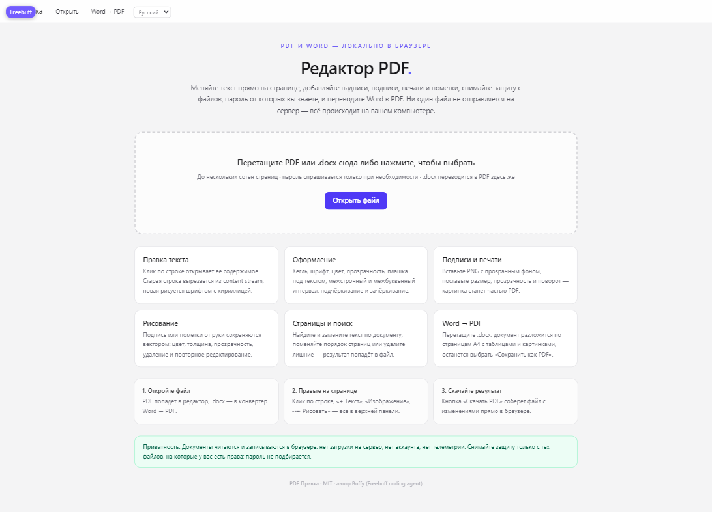
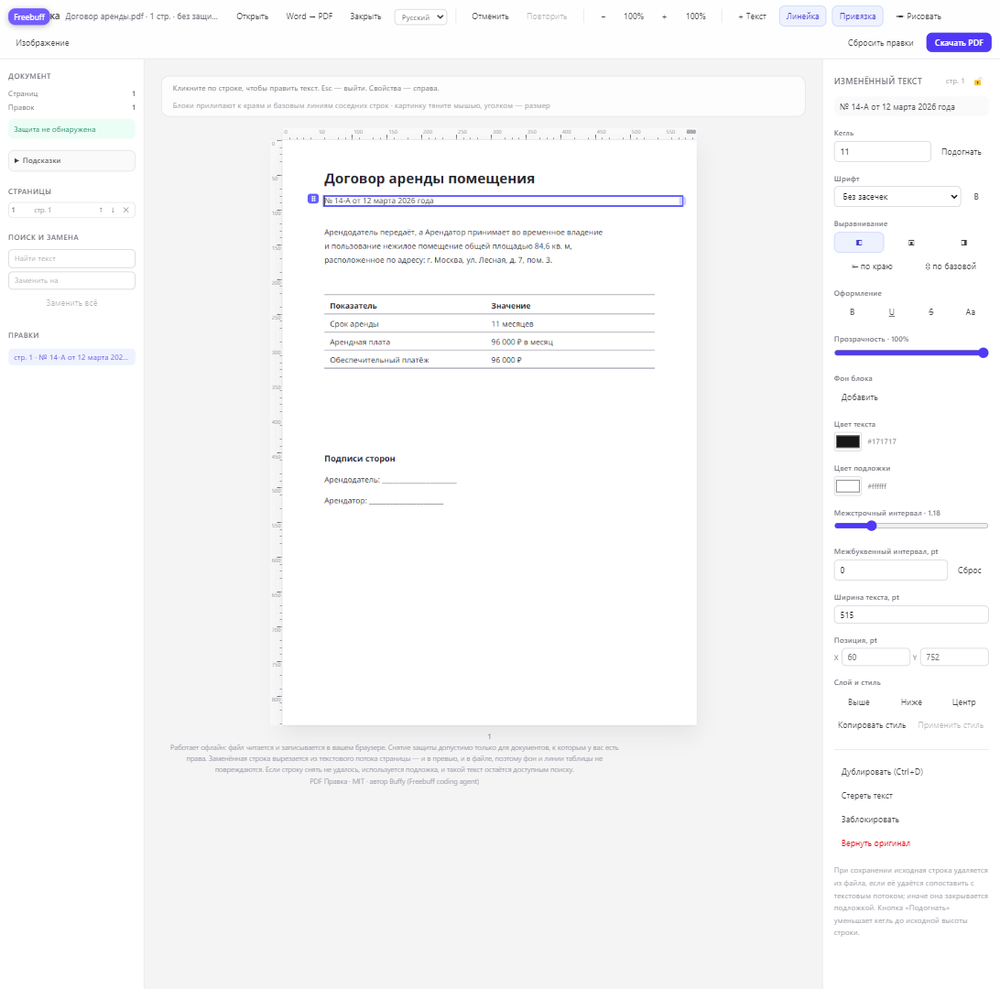

# PDF Правка

Редактор PDF, который целиком работает в браузере: файлы читаются и записываются на вашем
компьютере и никуда не отправляются. Правка идёт не «заплаткой поверх», а по-настоящему — старая
строка вырезается из content stream страницы, а новая рисуется встроенным шрифтом с кириллицей.

Автор: **Buffy (Freebuff coding agent)** · Лицензия: [MIT](LICENSE)





---

## Возможности

**Текст**
- Клик по строке — правка на месте, с живым превью: строка уже удалена из страницы, а не закрашена.
- Кегль, шрифт (с засечками / без), полужирный, подчёркивание, зачёркивание, регистр.
- Цвет, прозрачность, фон-плашка под блоком, межстрочный и межбуквенный интервал.
- Выравнивание по краям и центру, автоподгонка кегля под исходную высоту строки.
- «Копировать стиль» / «Применить стиль» — как format painter в платных редакторах.
- Точные координаты X/Y, ширина, слои (выше/ниже), блокировка от случайного сдвига.

**Новые объекты**
- Новые текстовые блоки в любом месте страницы.
- Изображения PNG/JPEG: подпись, печать, логотип. Прозрачность, поворот вокруг центра,
  пропорциональное изменение размера, блокировка.
- Рисование от руки: подпись или пометки вектором, с цветом, толщиной и прозрачностью.

**Документ**
- Поиск по тексту с переходом к найденной строке и заменой во всём документе.
- Порядок страниц (выше/ниже) и удаление страниц — применяются и в превью, и в файле.
- Снятие защиты: ограничения владельца снимаются сразу, для пароля на открытие его нужно
  ввести. Подбор пароля не выполняется.
- Отмена/повтор на 50 шагов, горячие клавиши, линейки и привязка к соседнему тексту.

**Word → PDF**
- Перетащите `.docx` в окно (или нажмите «Word → PDF»): документ раскладывается по страницам A4
  с таблицами, списками и картинками, затем «Сохранить как PDF» открывает системный диалог
  печати — выберите в нём принтер «Сохранить как PDF».

**Языки интерфейса**
- Русский и английский полностью переведены; язык выбирается в верхней панели (селект рядом
  с кнопкой «Открыть»).
- При первом запуске язык берётся из настроек браузера, выбор запоминается в `localStorage`
  и применяется к атрибуту `<html lang>`.
- Новый язык добавляется одним файлом: код языка в `LANGS` и словарь в `src/i18n/locales.ts`.
  Тип `MessageKey` не даст собрать проект с непереведённым ключом.

---

## Установка (Windows)

1. Скачайте папку проекта (или `git clone`).
2. Дважды щёлкните **`install.cmd`**.
3. Скрипт поставит зависимости, соберёт приложение, поднимет локальный сервер и откроет
   редактор в браузере. Окно консоли закрывать нельзя — это и есть сервер.

Дальнейшие запуски — **`start.cmd`**. Нужен [Bun](https://bun.sh) или [Node.js 20+](https://nodejs.org).

## Установка (macOS / Linux)

```sh
chmod +x install.sh start.sh
./install.sh     # установка и первый запуск
./start.sh       # последующие запуски
```

## Разработка

```sh
bun install
bun run dev          # http://127.0.0.1:5173
bun run typecheck    # TypeScript обеих конфигураций
bun run verify:pdf   # экспорт и снятие защиты в Node
bun run verify:stream # сопоставление строк в content stream
bun run build         # сборка в dist/
bun run start         # локальный сервер собранного приложения
```

## Публикация на GitHub Pages

В репозитории лежит готовый workflow `.github/workflows/deploy.yml`: при каждом пуше в `main`
он собирает приложение и публикует его на GitHub Pages.

1. Создайте репозиторий на GitHub и запушьте ветку `main`.
2. В репозитории откройте **Settings → Pages → Build and deployment → Source** и выберите
   **GitHub Actions** (один раз).
3. Следующий пуш в `main` опубликует сайт по адресу `https://<пользователь>.github.io/<репозиторий>/`.

Как это устроено:

- `vite.config.ts` берёт `base` из переменной `VITE_BASE`; workflow выставляет
  `VITE_BASE=/${{ github.event.repository.name }}/`, поэтому имя репозитория хардкодить не нужно;
- для Pages-сборки Cloudflare-плагин отключается, а результат кладётся в `dist/pages`
  (локальная сборка по-прежнему пишет `dist/client` + `dist/worker` для Cloudflare);
- workflow добавляет `404.html` (SPA-fallback) и `.nojekyll`.

Локальная проверка сборки с подпапкой (Git Bash на Windows — с `MSYS_NO_PATHCONV=1`, иначе
путь `/repo/` будет преобразован в файловый):

```sh
MSYS_NO_PATHCONV=1 VITE_BASE=/repo/ bun run build   # macOS/Linux — без префикса
grep -oE '(src|href)="/repo/[^"]+"' dist/pages/index.html
ls dist/pages/assets dist/pages/fonts
```

В `index.html` пути должны начинаться с `/repo/assets/…`, а папки `assets` и `fonts` —
существовать. CSS-ссылки на шрифты Vite также переписывает на `/repo/fonts/…`.

### Другие хостинги

Сборка — статический сайт: содержимое `dist/client` можно загрузить на Netlify, Cloudflare Pages
или любой другой статический хостинг (тогда `base` остаётся `/`). Для Cloudflare Workers
разворачивается `dist/pdf_editor` по манифесту `deploy.json`.

---

## Как это работает

- `src/pdf/pdfjs.ts` — PDF.js: рендер страниц, извлечение текста с координатами, пароль.
- `src/pdf/content.ts` — токенизатор content stream, ToUnicode CMap, пути, `blankRanges`,
  поиск украшений текста (подчёркиваний).
- `src/pdf/export.ts` — вырезание старых строк из потока, отрисовка нового текста, изображений,
  линий, удаление страниц и переупорядочивание.
- `src/pdf/model.ts` — модель документа (`TextEdit`, `ImageEdit`, `StrokeEdit`), перенос строк,
  измерение текста.
- `src/pdf/render.ts` — рендер страницы и подбор цвета подложки по пикселям вокруг строки.
- `src/pdf/decrypt.ts` — определение защиты и сохранение копии без шифрования.
- `src/client/App.tsx` — состояние документа, история, слои, поиск, экспорт.
- `src/i18n` — словари RU/EN, контекст `useI18n()`/`useT()` и автоопределение языка.
- `src/components/PageView.tsx` — canvas, клики по строкам, перетаскивание, рисование.
- `src/components/WordToPdf.tsx` — разбор `.docx` и печать страниц A4.

Если строку не удаётся сопоставить с потоком (например, текст внутри Form XObject), используется
подложка в цвет фона: визуально строка заменена, но остаётся доступной поиску.

## Ограничения

- Работает только с текстом, который есть в content stream; сканы без OCR редактировать нельзя.
- Сложная типографика (кернинг, лигатуры, произвольные шрифты) при правке заменяется
  встроенным Noto Sans/Serif.
- Поворот страниц документа и поворот текстовых блоков не поддерживаются (изображения
  поворачиваются).
- Word → PDF использует печать браузера: получается настоящий PDF с текстовым слоем, но файл
  сохраняется через диалог «Сохранить как PDF». Точная вёрстка сложных документов Word
  ограничена возможностями `docx-preview`.
- Поиск и замена работают по страницам, которые уже отрисованы в превью (прокрутите документ,
  чтобы охватить все страницы).

## Лицензия и шрифты

Код — MIT, автор **Buffy (Freebuff coding agent)**. Шрифты Noto Sans / Noto Serif —
SIL Open Font License 1.1 (`public/fonts`), библиотеки `pdfjs-dist`, `@cantoo/pdf-lib`,
`docx-preview` — под их собственными лицензиями.
